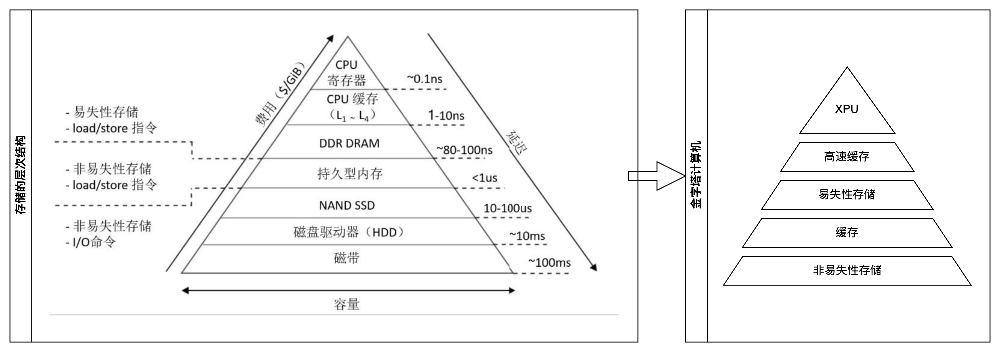

# 模型

## 金字塔计算机模型

在金字塔模型中的连续的两个不同存储层之间都有缓存的存在，这种结构决定了其实现效率最大化的必然只能是顺序读写，追加写的 FIFO 队列，或者说是类磁带的读写策略，多层就是多个磁带，上层的磁带读写速度都比下层快；
数据的操作策略：
- 数据是不可变的，删除时只打标记，用遗忘代替就地更新；
- 在数据从 n 层转移到 n+1 层的时候，可以对数据进行真正删除，也就是遗忘处理；
